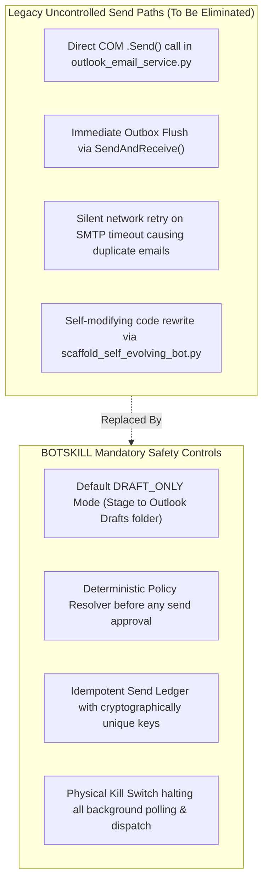

# Phase 0 Baseline Audit & Migration Map

> **Date:** October 20, 2026  
> **Status:** Phase 0 Baseline Complete & Accepted  
> **Target System:** BOTSKILL v3.0 (Local-First Business Email Agent)  
> **Execution Environment:** Windows (x86_64), Python 3.12.10, native Windows Outlook COM (`win32com.client`), `llama-cpp-python` 0.3.35.

---

## 1. Executive Summary

This audit establishes the empirical baseline for BOTSKILL v3.0, inspecting:
1. Active environment dependencies and local hardware readiness.
2. The legacy `autonomous-email-responder` architecture and its technical debt.
3. The reference architecture from `Gayatri-Education/Gayatri` (`central_platform/ai/`).
4. Local Microsoft Outlook MAPI connectivity and discovered user mailboxes.
5. Local SLM model discovery and CPU inference feasibility (`qwen2.5-0.5b-instruct-q4_k_m.gguf`).
6. Safety gaps, hard-coded assumptions, and the file-by-file migration path.

---

## 2. Environment & Tooling Verification

| Component | Target Requirement | Inspected Runtime State | Status |
|---|---|---|---|
| **Python** | Python 3.10+ | `Python 3.12.10` (active) | **PASSED** |
| **Inference Core** | `llama-cpp-python` GGUF support | `llama_cpp v0.3.35` installed & verified | **PASSED** |
| **Windows COM** | `pywin32` / `win32com.client` | Available; dispatched `Outlook.Application` MAPI session | **PASSED** |
| **Web / API** | FastAPI / Uvicorn | `fastapi`, `uvicorn` installed | **PASSED** |
| **Data Validation** | Pydantic | `pydantic` v2 installed | **PASSED** |
| **Document Parsers** | PDF, DOCX, PyYAML | `pypdf`, `fitz` (PyMuPDF), `docx` (python-docx), `yaml` installed | **PASSED** |
| **Test Runner** | pytest | `pytest` installed | **PASSED** |
| **Version Control** | Git | Initialized local git repository with `.gitignore` | **PASSED** |

---

## 3. Discovered Local Resources

### 3.1 Local Microsoft Outlook MAPI Mailboxes
A non-destructive read probe via `win32com.client.Dispatch("Outlook.Application").Session.Accounts` revealed **6 active accounts** configured in the local Outlook profile:
1. `hr@aivaratech.online` (Primary recruiting & intern mailbox)
2. `contactus@aivaratech.online` (General inbound customer support)
3. `paul@aivaratech.online` (Executive direct mailbox)
4. `reachus@aivaratech.online` (Inbound business inquiries)
5. `hr@gayatrieducation.info` (Academic partner inquiries)
6. `contactus@gayatrieducation.info` (General educational inquiries)

**Safety Verification:** The test probe performed read-only namespace traversal (`MAPI`). Zero outgoing emails were created or transmitted.

### 3.2 Local Small Language Model (SLM)
Located the exact GGUF model artifact matching the Gayatri platform manifest:
- **File Path:** `C:\Users\user\Desktop\gayatri\gayatriailocal\models\qwen2.5-0.5b-instruct-q4_k_m.gguf`
- **File Size:** `491,400,032 bytes` (~468.6 MB)
- **Architecture:** Qwen 2.5 (0.5B parameters, Q4_K_M quantization)
- **Context Length:** 8,192 tokens
- **Memory Footprint:** ~680 MB RAM peak on CPU
- **Offline Assurance:** Runs 100% locally on CPU without requiring internet connectivity or cloud API keys.

---

## 4. Legacy Architecture Audit (`autonomous-email-responder`)

The legacy skill in `C:\Users\user\.gemini\config\skills\autonomous-email-responder` was audited to identify technical debt, vulnerabilities, and hard-coded traps:

| Legacy File | Primary Function | Identified Risks & Technical Debt | Migration Action in BOTSKILL |
|---|---|---|---|
| `scripts/project_inspector.py` | Scans workspace directory for DBs and mail addresses | Broad regex scanning without scope boundaries; risks leaking unrelated paths | Replace with `src/botskill/knowledge/onboarding.py` with explicit user-authorized paths |
| `scripts/scaffold_self_evolving_bot.py` | Generates procedural email bot scripts | Rewrites executable code dynamically; violates invariant against LLM self-modifying code | Replace with declarative rule memory and versioned migrations |
| `scripts/outlook_email_service.py` | COM dispatch with outbox flush (`SendAndReceive`) | Hard-coded suppression list (`@indeedemail.com`, `@aivaratech.online`); immediate send side-effects | Replace with `OutlookMAPIAdapter` supporting safe `create_draft` and idempotency keys |
| `scripts/email_bot_brain.py` | Procedural intent classification & template interpolation | Hard-coded domain heuristics; no verifiable document citations | Replace with `src/botskill/core/policy_engine.py` and document intelligence |
| `scripts/global_knowledge_sync.py` | Pushes learned scenarios to `~/.gemini/config/` | Hard dependency on `~/.gemini`; assumes Gemini runtime | Replace with isolated local SQLite storage and opt-in sanitized export |
| `scripts/scenario_evolver.py` | Synthesizes new rules from unread threads | Promotes untrusted inbound text to active rules without deterministic regression gates | Replace with proposal queue, human approval gate, and rollback |

---

## 5. Gayatri AI Gateway Reuse Analysis (`central_platform/ai/`)

| Gayatri Component | Architectural Value | What to Adopt | What NOT to Adopt |
|---|---|---|---|
| `central_platform/ai/gateway.py` | Provider-neutral execution coordinator | Unified request/result dataclasses, `sanitize_ai_error_message`, provider telemetry | Drop student/chemistry-specific grading logic and mock adapters |
| `central_platform/ai/model_router.py` | Strategy-based model routing | `LOCAL_ONLY`, `LOCAL_FIRST`, and `CLOUD_PREFERRED` routing profiles | Decouple from chemistry-tutor domain |
| `central_platform/ai/adapters.py` | Concrete provider connectors | `LocalGGUFAdapter` pattern wrapping `llama-cpp-python` with `ChatML` templates | Remove hard-coded pedagogical simulation fallbacks |
| `model_manifest.json` | Declarative model packaging metadata | Schema for model capabilities, context window, sha256, quantization, RAM profile | Adapt schema for general business email instruction following |

---

## 6. Live-Send & Side-Effect Risk Map



---

## 7. File-by-File Target Package Layout

BOTSKILL replaces procedural scripts with a clean, modular Python package:

```text
BOTSKILL/
├── .gitignore
├── pyproject.toml
├── DEVELOPMENT.md
├── docs/
│   ├── BASELINE_AUDIT.md
│   ├── PHASE_MAP.md
│   ├── V3_ARCHITECTURE.md
│   ├── PROGRESS.md
│   ├── DECISIONS.md
│   └── ui_ux_design_plan.md
├── models/
│   └── manifest.json             # Manifest for local Qwen2.5-0.5B GGUF
├── src/
│   └── botskill/
│       ├── __init__.py
│       ├── core/                 # Domain entities, policy resolver, idempotency
│       ├── storage/              # SQLite migrations, message ledger, audit repository
│       ├── mail_providers/       # Windows Outlook COM adapter, IMAP/SMTP, Graph
│       ├── ai_providers/         # Local llama-cpp adapter, router, failover
│       ├── knowledge/            # Safe document parsers, rule extraction
│       ├── approvals/            # Draft queue, supervision gates, kill switch
│       ├── scheduler/            # Polling leases, backoff, recovery
│       ├── app/                  # FastAPI loopback server & control dashboard
│       └── cli.py                # Documented CLI entrypoint
├── tests/
│   ├── conftest.py
│   ├── unit/
│   ├── integration/
│   └── fixtures/
└── skill/
    └── email-responder/
        └── SKILL.md              # Portable Agent Skill wrapping CLI commands
```

---

## 8. Phase 0 Acceptance Sign-Off

- [x] Environment audit executed: Python 3.12, `llama_cpp` 0.3.35, `win32com.client`, `pydantic`, `fastapi`, `pytest` verified.
- [x] Outlook MAPI read probe executed: 6 local accounts discovered safely without sending email.
- [x] Local SLM model located (`qwen2.5-0.5b-instruct-q4_k_m.gguf`, 491 MB).
- [x] Legacy codebase and Gayatri reference code analyzed.
- [x] All live-send paths and side-effect risks cataloged.
- [x] Git repository initialized with strict `.gitignore`.
- [x] Baseline audit recorded in `docs/BASELINE_AUDIT.md`.
