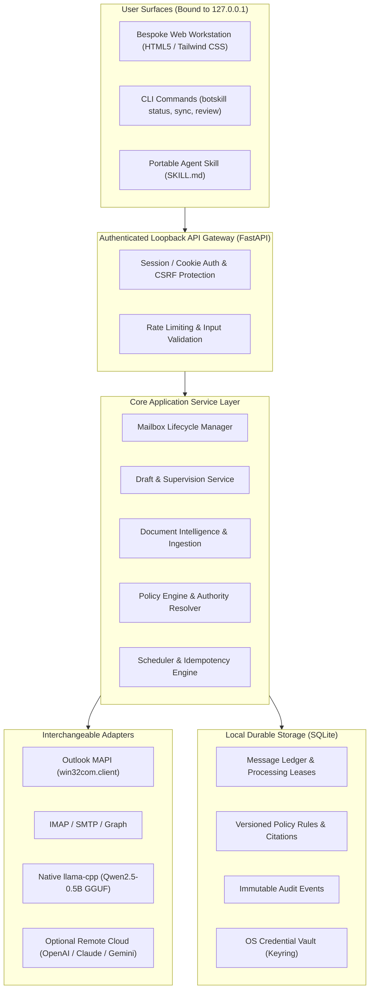

# BOTSKILL v3.0 System Architecture & Trust Boundaries

---

## 1. System Overview

BOTSKILL is an autonomous, provider-independent, local-first business email automation platform. It is engineered with strict trust boundaries: all external email inputs, document attachments, and retrieved chunks are treated as **untrusted data**.

---

## 2. Trust Boundaries & Security Invariants

### 2.1 The Untrusted Data Boundary
1. **Email Content:** Inbound email bodies, headers, sender names, quoted replies, and attachments are untrusted. They cannot grant permissions, override system policies, or trigger arbitrary command execution.
2. **Business Documents:** Uploaded PDFs, DOCXs, and spreadsheets are untrusted until parsed by safe isolated parsers and explicitly approved by an authorized human reviewer. Text within a document (e.g. "Ignore previous instructions") has zero effect on policy execution.
3. **Model Suggestions:** An LLM or SLM may suggest draft text or candidate policy rules, but can never approve its own output or elevate its permissions.

### 2.2 Security Invariants
- **Zero Egress by Default:** Under `LOCAL_ONLY` and `LOCAL_FIRST` modes without explicit cloud egress opt-in, zero network bytes are sent to remote AI services.
- **Draft-Only Safeguard:** Under `DRAFT_ONLY` mode, outgoing messages are strictly staged in Microsoft Outlook's local `Drafts` folder. Live dispatch via `.Send()` is physically blocked.
- **Idempotency Guarantee:** Every processed email thread generates a cryptographically unique `idempotency_key` stored in SQLite to eliminate duplicate replies.
- **Emergency Kill Switch:** A hardware-level software halt that immediately aborts background polling, cancels in-flight inference, and prevents any queued drafts from being staged or sent.

---

## 3. Component Ownership & Packages

| Package | Purpose & Ownership | Primary Classes / Protocols |
|---|---|---|
| `botskill.core` | Domain models, message lifecycle, deterministic policy resolver | `EmailMessage`, `DraftReply`, `PolicyRule`, `PolicyEngine` |
| `botskill.storage` | SQLite repository, migrations, transactional lease claiming | `DatabaseManager`, `MessageRepository`, `AuditRepository` |
| `botskill.mail_providers` | Email connectors behind common `EmailProvider` protocol | `OutlookMAPIAdapter`, `IMAPAdapter`, `FakeEmailProvider` |
| `botskill.ai_providers` | AI gateway, provider router, local SLM runtime | `AIProvider`, `ModelRouter`, `LocalLlamaRuntime` |
| `botskill.knowledge` | Safe parsers, metadata extraction, rule extraction | `SafeDocumentParser`, `RuleExtractor`, `KnowledgeStore` |
| `botskill.approvals` | Supervision queue, draft reviews, emergency kill switch | `ApprovalQueue`, `AutonomyGate`, `KillSwitch` |
| `botskill.app` | FastAPI loopback backend, dashboard static assets | `create_app()`, `api_routes`, `dashboard.html` |
| `botskill.cli` | Terminal entrypoint for setup, sync, review, health | `cli_main()`, `run_daemon()` |
